

<picture>
  <source media="(prefers-color-scheme: dark)" srcset="./assets/header-dark.svg"/>
  <source media="(prefers-color-scheme: light)" srcset="./assets/header-light.svg"/>
  
</picture>

  
  
  
  

<picture>
  <source media="(prefers-color-scheme: dark)" srcset="./assets/marquee-dark.svg"/>
  <source media="(prefers-color-scheme: light)" srcset="./assets/marquee-light.svg"/>
  
</picture>

 

<picture>
  <source media="(prefers-color-scheme: dark)" srcset="./assets/sec-now-dark.svg"/>
  <source media="(prefers-color-scheme: light)" srcset="./assets/sec-now-light.svg"/>
  
</picture>
<picture>
  <source media="(prefers-color-scheme: dark)" srcset="./assets/now-dark.svg"/>
  <source media="(prefers-color-scheme: light)" srcset="./assets/now-light.svg"/>
  
</picture>

 

I like machine learning that **holds up under scrutiny**: out-of-fold evaluation, calibrated probabilities, honest ablations, and failure analysis, across **deep learning for vision** and **RAG for language**. This summer I built an on-prem LLM + RAG platform at the Department of Atomic Energy; right now I'm putting the same rigor into a medical-imaging project.

 

<picture>
  <source media="(prefers-color-scheme: dark)" srcset="./assets/sec-stack-dark.svg"/>
  <source media="(prefers-color-scheme: light)" srcset="./assets/sec-stack-light.svg"/>
  
</picture>
<picture>
  <source media="(prefers-color-scheme: dark)" srcset="./assets/skills-dark.svg"/>
  <source media="(prefers-color-scheme: light)" srcset="./assets/skills-light.svg"/>
  
</picture>

 

<picture>
  <source media="(prefers-color-scheme: dark)" srcset="./assets/sec-flagship-dark.svg"/>
  <source media="(prefers-color-scheme: light)" srcset="./assets/sec-flagship-light.svg"/>
  
</picture>

### 👁️ Diabetic Retinopathy Grading with CNN Ensembles
**PyTorch · OpenCV · Scikit-learn · NumPy · Matplotlib** &nbsp;·&nbsp; [**📂 Repository**](https://github.com/Dhruv-ub/YOUR_DR_REPO)

A 5-grade DR classifier on APTOS 2019, built around **evaluation you can trust** rather than a single lucky validation score. EfficientNet-B0 and B2 are fine-tuned from ImageNet weights with a **hybrid head**: 5 class logits plus 1 **ordinal regression** output, because DR grades are ordered (calling a 4 a "0" is worse than calling it a "3").

<picture>
  <source media="(prefers-color-scheme: dark)" srcset="./assets/metrics-dark.svg"/>
  <source media="(prefers-color-scheme: light)" srcset="./assets/metrics-light.svg"/>
  
</picture>
<picture>
  <source media="(prefers-color-scheme: dark)" srcset="./assets/pipeline-dark.svg"/>
  <source media="(prefers-color-scheme: light)" srcset="./assets/pipeline-light.svg"/>
  
</picture>

<table>
<tr><th align="left">What the experiments showed</th><th align="left">Evidence (5-fold out-of-fold, n = 3,295)</th></tr>
<tr><td>Ben-Graham contrast preprocessing <b>hurt</b></td><td>macro PR-AUC 0.705 vs 0.750; QWK 0.898 vs 0.916 → kept plain crop and reported the negative result</td></tr>
<tr><td>B0 and B2 are a <b>tie</b></td><td>0.750 vs 0.740 macro PR-AUC, within fold noise (std ≈ 0.025–0.028)</td></tr>
<tr><td>Ensembling helps a little</td><td>B0 + B2 reaches 0.759 (+0.008 over B0): real but small, so I don't oversell it</td></tr>
<tr><td>The raw model was <b>overconfident</b></td><td>temperature T ≈ 1.56; ECE 0.065 → 0.021 without changing the ranking</td></tr>
<tr><td>Where it fails</td><td>On the 367-image holdout, 22 Moderate cases were called Severe and 13 Proliferative cases were missed (7 of them called Moderate)</td></tr>
</table>

**Method highlights:** one-time cached 512 px preprocessing (shared verbatim between training and inference) · GPU-side augmentation · EMA weights with a fixed schedule (no best-epoch picking) · 5-fold cross-validation with a locked holdout · ensemble chosen on out-of-fold data only · cut points, temperature and screening threshold fitted on out-of-fold data.

> ⚠️ Research prototype on a single public dataset (APTOS 2019, image-level split). The holdout was scored twice; out-of-fold results are the headline. Not clinically validated, not a medical device.

 

<picture>
  <source media="(prefers-color-scheme: dark)" srcset="./assets/sec-more-dark.svg"/>
  <source media="(prefers-color-scheme: light)" srcset="./assets/sec-more-light.svg"/>
  
</picture>

<table>
<tr>
<td width="50%" valign="top">

#### 📄 Retrieval-Augmented Document QA
`Python` `PyTorch` `FAISS` `TinyLlama` `Gradio` · [🤗 Live demo](https://huggingface.co/spaces/YOUR_SPACE)

- End-to-end RAG pipeline with TinyLlama, tuned for low-latency **CPU-only** inference.
- **FAISS** vector search for sub-second semantic retrieval over uploaded PDFs.
- Gradio app on Hugging Face for grounded, real-time Q&A.

</td>
<td width="50%" valign="top">

#### 🏢 AI Engineering Intern · Dept. of Atomic Energy
`llama.cpp` `GGUF` `RAG` `OCR` `FastAPI` `React`

- Deployed quantized GGUF LLMs with **llama.cpp** for secure, CPU-only on-prem inference.
- Built a RAG pipeline (OCR → embeddings → vector retrieval → QA) over scanned confidential documents.
- Cut document lookup from **15 minutes to under 30 seconds**.

</td>
</tr>
</table>

<b>🧱 Full-stack &amp; systems work (click to expand)</b>

 

**🛒 Snapcart: real-time quick commerce** · `Next.js 16` `TypeScript` `Socket.io` `Redux Toolkit` `Leaflet` `Stripe`
- Decoupled the **Socket.io** server from the Next.js core to handle geospatial events independently.
- Live order tracking with **Leaflet + WebSockets**; role-based access (Admin / User / Delivery) with **NextAuth v5**.
- **Redux Toolkit** state management and **Stripe** webhooks for resilient payments.

**🧪 Chemical Parameter Visualizer** · `Django` `React.js` `PyQt5` `SQLite` `Pandas` `Chart.js`
- One Django API serving both a React web client and a PyQt5 desktop app.
- **Pandas** summaries over industrial CSV datasets, plus PDF report export.

 

<picture>
  <source media="(prefers-color-scheme: dark)" srcset="./assets/sec-journey-dark.svg"/>
  <source media="(prefers-color-scheme: light)" srcset="./assets/sec-journey-light.svg"/>
  
</picture>
<picture>
  <source media="(prefers-color-scheme: dark)" srcset="./assets/journey-dark.svg"/>
  <source media="(prefers-color-scheme: light)" srcset="./assets/journey-light.svg"/>
  
</picture>

 

<picture>
  <source media="(prefers-color-scheme: dark)" srcset="./assets/sec-oss-dark.svg"/>
  <source media="(prefers-color-scheme: light)" srcset="./assets/sec-oss-light.svg"/>
  
</picture>

### [OpenWISP](https://github.com/openwisp)
- **NetJSONGraph.js:** resolved frontend label overlap and rendering issues, improving map readability for large network topologies.
- **Wifi Login Pages:** contributed to configuration management improvements and CI/CD pipeline fixes.

 

<picture>
  <source media="(prefers-color-scheme: dark)" srcset="./assets/sec-activity-dark.svg"/>
  <source media="(prefers-color-scheme: light)" srcset="./assets/sec-activity-light.svg"/>
  
</picture>

<picture>
  <source media="(prefers-color-scheme: dark)" srcset="https://raw.githubusercontent.com/Dhruv-ub/Dhruv-ub/output/github-snake-dark.svg"/>
  <source media="(prefers-color-scheme: light)" srcset="https://raw.githubusercontent.com/Dhruv-ub/Dhruv-ub/output/github-snake.svg"/>
  
</picture>

<picture>
  <source media="(prefers-color-scheme: dark)" srcset="./profile-summary-card-output/tokyonight/3-stats.svg"/>
  <source media="(prefers-color-scheme: light)" srcset="./profile-summary-card-output/default/3-stats.svg"/>
  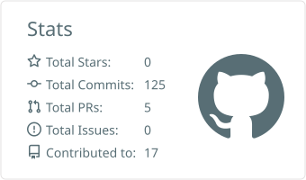
</picture>
<picture>
  <source media="(prefers-color-scheme: dark)" srcset="./profile-summary-card-output/tokyonight/2-most-commit-language.svg"/>
  <source media="(prefers-color-scheme: light)" srcset="./profile-summary-card-output/default/2-most-commit-language.svg"/>
  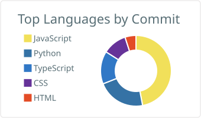
</picture>

<picture>
  <source media="(prefers-color-scheme: dark)" srcset="./assets/footer-dark.svg"/>
  <source media="(prefers-color-scheme: light)" srcset="./assets/footer-light.svg"/>
  
</picture>

<!--  -->

